# UMA ERP — Cross-User & Multi-Device Data Visibility Audit

**Date:** October 14, 2026  
**Target Environment:** Frontend (`https://fe-erp-uma-test-2.vercel.app/`), Backend (`https://erpuma.pythonanywhere.com/api/`), Database (`db.sqlite3` on PythonAnywhere)  
**System:** UMA Techno Fab Private Limited MTO ERP  

---

## 1. Executive Summary & Problem Statement

The user reported a critical multi-device data inconsistency across laptops:
> *"When my friend opened the URL on another laptop: https://fe-erp-uma-test-2.vercel.app/login ... I had registered 3 users but he saw 2 users ... Now I have user Durgesh Jadav and 4 friends logged in ... Whatever data my friend adds, I cannot see, and what I add, they cannot see. Why is this happening if it is the same database?"*

User screenshots provided concrete visual evidence of the discrepancy across machines:
- **Laptop 1 (Hardik Daki):** Saw **4 employees** (`EMP-000 Hardik Daki`, `EMP-001 Durgesh Jadav`, `002 Deepbhai Manvar`, `003 hemant bhai`).
- **Laptop 2 (Durgesh Jadav):** Saw **3 employees** (`EMP-000 Hardik Daki`, `EMP-001 Durgesh Jadav`, `EMP-003 Kuldeep PATEL`).
- **Laptop 3 (Durgesh Jadav):** Saw **2 employees** (`EMP-000 Hardik Daki`, `EMP-001 Durgesh Jadav`).
- **CRM / Sales / PO Modules:** Records created by one user (leads, enquiries, quotations, customer POs) were missing on other users' devices.

---

## 2. Root Cause Analysis: The 5 Fundamental Breakdowns

Our exhaustive code and database investigation across `ERP-Test-1` and `BE-ERP-UMA` uncovered 5 interconnected architectural failures that created local "data silos" on each laptop:

```mermaid
flowchart TD
    subgraph ProblemFlow["Broken Architecture Before Fix"]
        A["User enters username/password on Laptop"] --> B["src/app/login/page.tsx: In-Memory/LocalStorage check"]
        B -->|Credentials pass locally| C["User admitted to dashboard WITHOUT valid JWT access token"]
        C --> D["User creates Record (e.g. Lead, Employee, PO)"]
        D --> E["POST https://erpuma.pythonanywhere.com/api/..."]
        E -->|Missing/invalid token| F["Backend returns HTTP 401 Unauthorized"]
        F --> G["Component catch(err) swallows error"]
        G --> H["Writes record ONLY to laptop's localStorage (UMA_ERP_...)"]
        H --> I["Record visible ONLY on that laptop, NEVER written to central DB!"]
    end
```



### Breakdown 1: Frontend Login Swallowed Backend 401 Failures
- **File:** `src/app/login/page.tsx`
- **Flaw:** The login handler (`handleSubmit`) was performing a purely synchronous, client-side search across whatever `employees` were present in that specific laptop's `localStorage`:
  ```typescript
  const success = login(cleanUser, cleanPass);
  if (success) { router.push('/'); }
  ```
  Inside `login()`, `api.auth.login()` was called as an asynchronous background fire-and-forget promise with `.catch(() => {})`. If the user's password didn't match the PythonAnywhere database or if the network was slow, **the backend rejected authentication**, no JWT token (`access_token`) was written to `localStorage`, but the user was **still let in** to the application as a fake local session.

### Breakdown 2: Hardcoded Broken Auto-Auth Fallback & Lockout Cooldown
- **File:** `src/lib/apiClient.ts`
- **Flaw:** When `localStorage.getItem('access_token')` was missing, `getOrRefreshToken()` attempted to auto-authenticate with hardcoded credentials:
  ```typescript
  body: JSON.stringify({ username: 'admin', password: 'admin123' })
  ```
  On the live PythonAnywhere server, `admin` had a different password or did not exist. Every API mutation thus failed with `401 Unauthorized`. Furthermore, `apiClient.ts` implemented a 30-second penalty lockout:
  ```typescript
  const AUTH_FAILURE_COOLDOWN_MS = 30000;
  ```
  This completely blocked subsequent requests for 30 seconds across the entire frontend application.

### Breakdown 3: Mutations Caught Errors and Saved Isolated Records in LocalStorage
- **Files:** `src/components/employees/EmployeeFormModal.tsx`, `src/context/ERPContext.tsx`
- **Flaw:** When creating or updating records, if the API call failed (due to 401 Unauthorized), the catch blocks caught the failure and fabricated a local record:
  ```typescript
  // EmployeeFormModal.tsx lines 283-289
  } catch (apiErr: any) {
    if (apiErr?.status === 400) throw apiErr;
    res = { ...payload, id: payload.id || `EMP-${employees.length + 1}` };
  }
  addEmployee(res); // Saved ONLY to this laptop's UMA_ERP_employees!
  ```
  **Why Kuldeep PATEL appeared on Laptop 2 only:**
  When Laptop 2 created Kuldeep Patel, the browser had no valid JWT token. PythonAnywhere returned 401. The catch block caught the 401, assigned `EMP-003` locally, and saved it only into Laptop 2's `localStorage.getItem('UMA_ERP_employees')`. PythonAnywhere's central SQLite database **never received Kuldeep Patel**!

### Breakdown 4: Permanent Stale Cache in `apiClient.ts`
- **File:** `src/lib/apiClient.ts`
- **Flaw:** In `request<T>()`, GET requests unconditionally retrieved and returned whatever was stored in `localStorage.getItem('UMA_CACHE_GET:...')` without any mechanism to force bypass the cache. If a laptop loaded 2 employees a week ago, it permanently displayed those 2 employees even if 10 new employees were added to the database.

### Breakdown 5: ID Collisions Between Multiple Offline Laptops
- Both Laptop 1 and Laptop 2 independently calculated new IDs based on local array lengths:
  - Laptop 1 created an employee with `003` (`hemant bhai`).
  - Laptop 2 created an employee with `EMP-003` (`Kuldeep PATEL`).
  When Laptop 2 eventually attempted to sync, the backend threw an `IntegrityError: UNIQUE constraint failed: authentication_user.id`, rejecting the record.

---

## 3. Discrepancy Breakdown by Laptop

| Laptop / User Session | What Was Displayed | Technical Explanation |
| :--- | :--- | :--- |
| **Laptop 1 (Hardik Daki)** | 4 Employees: `EMP-000`, `EMP-001`, `002 Deepbhai`, `003 hemant` | `002` and `003` were legitimately saved to PythonAnywhere DB on 2026-10-13 12:21 UTC when an active token existed. Laptop 1 fetched these from DB. |
| **Laptop 2 (Durgesh Jadav)** | 3 Employees: `EMP-000`, `EMP-001`, `EMP-003 Kuldeep` | Created `Kuldeep PATEL` while token had expired. POST failed with 401; catch block saved it solely to Laptop 2's `UMA_ERP_employees` in localStorage. |
| **Laptop 3 (Durgesh Jadav)** | 2 Employees: `EMP-000`, `EMP-001` | Had stale cache from initial deployment. Auto-auth `admin/admin123` was failing with 401, so Laptop 3 fell back permanently to its initial cache. |

---

## 4. Key Takeaways

1. **A central database cannot share data if client mutations never reach it.**
2. **Offline-first fallback without user notification masks severe authentication failures.**
3. **Synchronizing user credentials and using standard JWT bearer tokens on all requests is mandatory for multi-device enterprise software.**
4. **Data visibility must respect RBAC data scopes (`all` vs. `own`) while guaranteeing shared business record persistence across all authorized users.**
